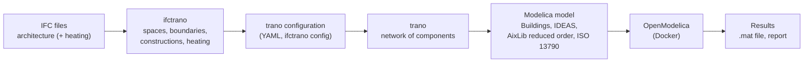

# How ifctrano works

ifctrano reads the geometry of an IFC model, derives the thermal zones and their envelope from it, and writes a
[trano](https://github.com/andoludo/trano) configuration. trano turns the configuration into a Modelica model for one
of several libraries, which OpenModelica simulates. This page explains each step, the assumptions made on the way and
what the generated models contain.

## Pipeline

`ifctrano create` runs the whole chain. `ifctrano config` stops at the configuration, which can be reviewed and edited
before `ifctrano from-config` builds (and optionally simulates) the model. Both routes produce the same model: the model
is always built from the configuration.

## IFC parsing

### What is read

| IFC entity | Use |
|---|---|
| `IfcSpace` | One thermal zone per space. Required: a model without spaces is rejected. |
| `IfcWall`, `IfcSlab`, `IfcRoof`, `IfcDoor`, `IfcWindow` | Envelope and internal elements of the spaces. |
| `IfcPlate` | Internal elements between two spaces only; plates on the envelope are ignored. |
| `IfcBuildingElementPart` | Parts of a wall or slab, merged into their parent element. |
| `IfcMaterialLayerSet` (through `IfcRelAssociatesMaterial` or `IfcMaterialLayerSetUsage`) | Constructions: names and thicknesses of the layers. |
| `IfcSIUnit` (length) | Millimetre models are converted to metres. |
| IFC4 MEP elements (heat generators, pumps, valves, radiators, ports) | Heating system, see [Systems](#systems). |

`IfcRelSpaceBoundary` is **not** used: space boundaries are rarely present, or reliable, in real models. ifctrano
derives them from the geometry instead.

### Spaces and boundaries

For each space, ifctrano:

1. computes its **oriented bounding box**, its floor area (footprint of its shape) and its average height (volume over
   floor area; the bounding box is used when the shape has no footprint);
2. finds the building elements within **0.5 m** of it (`clash_clearance_many` of IfcOpenShell's geometry tree);
3. keeps, for each of them, the **common surface** between the faces of the space's bounding box and of the
   element's: its area, its outward normal and its polygon;
4. replaces building element parts by their parent element, and keeps a single slab or roof where several cover the
   same surface with the same orientation.

An element whose common surfaces are found with two spaces, facing each other, is an **internal element** between
these spaces: the smaller of the two surfaces is its area. All other boundaries are **external**.

### Assumptions and known limitations

- Each `IfcSpace` is one zone: spaces are not merged into larger zones, and a space with an invalid shape is skipped
  (and logged).
- Bounding boxes approximate the geometry: curved or strongly non-convex spaces and elements get approximate areas.
- Only walls, slabs, roofs, doors and windows bound a space towards the outside; other elements (plates, columns,
  beams, curtain-wall members as such) are ignored on the envelope.
- An external boundary exchanges heat with the outdoor air, or with the ground for a floor: unheated neighbouring
  buildings, crawl spaces or spaces missing from the model are treated as outdoors.
- Only the thicknesses of the layers come from the IFC model: every material gets the same default thermal properties
  (conductivity 0.046 W/(m·K), specific heat capacity 940 J/(kg·K), density 80 kg/m³), as IFC models rarely carry
  them. Edit the `material` section of the configuration to use real values.

## Wall translation

### Kind of boundary

| Element | Tilt | Becomes |
|---|---|---|
| Wall, door, window | wall | external wall (doors too), or window |
| Roof | ceiling | external wall facing up |
| Slab, normal pointing up | ceiling | external wall facing up |
| Slab, normal pointing down | floor | floor on ground |
| Element shared by two spaces | wall, or floor and ceiling for slabs | internal wall between the two zones |

### Orientation

The orientation of a surface is given by its outward normal, measured from the north axis of the model (`+y` by
default, see `north_axis`). trano and the Modelica libraries use the azimuth of the Buildings library: radians from
south, positive towards west.

| Facade faces | Azimuth (rad) |
|---|---|
| South | 0 |
| West | π/2 (1.57) |
| North | π (3.14) |
| East | −π/2 (−1.57) |

Vertical surfaces are snapped to the closest of the eight main and intermediate directions. The orientation of roofs
and slabs does not change their physics: they are given the azimuth 0.

### Areas

- Walls are **gross** facade areas, windows included, as trano expects: trano cuts the windows out of the walls of
  their orientation.
- The walls and windows of a space are merged per orientation (one wall and one window area per orientation), with
  the construction of the first wall.
- Windows larger than the wall of their orientation (overlapping window boxes on glazed facades) are reduced to 90 %
  of the wall area. A wall is added where a space has windows without walls.

### Constructions

- Each `IfcMaterialLayerSet` becomes a construction named after the layer set (or `construction_<id>` when unnamed),
  with one layer per `IfcMaterialLayer`. Names are made valid Modelica identifiers, and distinct layer sets sharing a
  name get distinct names.
- Elements without a layer set (no association, `IfcMaterialList`, constituent sets) get `default_construction`
  (0.18 m of the default material); internal elements get `default_internal_construction`.
- Windows use a double glazing (3 mm glass, 12.7 mm air, 3 mm glass) with a frame U-value of 1.4 W/(m²·K).

## Modelling approach

### Zones

Each space is a zone of the chosen library; the envelope, internal walls and windows found above are attached to it.

| Library | Zone model | Envelope |
|---|---|---|
| `Buildings` (default) | `Buildings.ThermalZones.Detailed.MixedAir` | One-dimensional conduction through each layer, windows with solar transmission, long- and shortwave radiation exchange between surfaces, mixed air volume. |
| `IDEAS` | `IDEAS.Buildings.Components.Zone` | Components per wall, window, slab on ground and internal wall. |
| `reduced_order` | AixLib `ThermalZones.ReducedOrder.ThermalZone` | Envelope lumped into resistance–capacitance elements per orientation. |
| `iso_13790` | AixLib `ThermalZones.ISO13790.Zone5R1C` | Five resistances and one capacitance (ISO 13790 simple hourly method). |

The detailed libraries model each surface; the reduced-order ones are faster and coarser. The
[library comparison](../tutorials/use_different_libraries.md) shows how Buildings and IDEAS differ on the same
building. Every library is simulated in CI on the two zones model (`tests/test_simulation.py`).

### Thermal network and boundary conditions

- **Internal walls** couple the zones they separate; both sides keep their thermal mass.
- **External walls and roofs** exchange heat with the outdoor air and receive solar radiation according to their
  orientation and tilt; **floors on ground** sit on the ground, at 10 °C (283.15 K, trano's default) for Buildings
  and the reduced-order zone, while IDEAS and ISO 13790 model the ground themselves.
- **Weather**: trano's default, the Uccle (Belgium) typical year shipped with IDEAS, for every library.
- **Occupancy and infiltration**: trano's default occupancy, occupied from 7:00 to 19:00, with the internal gains
  `gain = [35; 70; 30]` (radiant, convective, latent) scaled by `heat_gain_if_occupied = 1/6/4`, and an air change
  rate of 0.9 1/h.
- Initial temperature of the zones: 21 °C.

All these values are in the configuration written by `ifctrano config`, where they can be changed.

## Systems

Without a heating model, the zones are free-floating: no emission or production system is generated. With heating
elements in the architecture file or in federated discipline files (`--hvac`), ifctrano builds the hydronic system
described in the [heating tutorial](../tutorials/heating_model.md):

| IFC | trano element | Modelica component (Buildings) |
|---|---|---|
| `IfcSpaceHeater` (radiator) | `radiator`, lumped per space | `Buildings.Fluid.HeatExchangers.Radiators.RadiatorEN442_2` |
| Radiator valve | `valve` | `Buildings.Fluid.Actuators.Valves.TwoWayEqualPercentage` |
| `IfcPump` | `pump` | `Buildings.Fluid.Movers.Preconfigured.SpeedControlled_y` (in a trano wrapper) |
| `IfcValve` (mixing) | `three_way_valve` | `Buildings.Fluid.Actuators.Valves.ThreeWayEqualPercentageLinear` |
| `IfcSensor` (temperature) | `temperature_sensor` | `Buildings.Fluid.Sensors.TemperatureTwoPort` |
| `IfcBoiler` | `boiler`, `without_storage` or `default` (with a storage tank) variant | `Buildings.Fluid.Boilers.BoilerPolynomial` (and `Buildings.Fluid.Storage.StratifiedEnhanced`) |
| Heat pump (`IfcUnitaryEquipment` recognised as such, or `--heat-generator`) | `boiler`, `air_water_heat_pump` or `water_water_heat_pump` variant | `Buildings.Fluid.HeatPumps.ModularReversible.AirToWaterTableData` or `Buildings.Fluid.HeatPumps.EquationFitReversible` |
| Radiator not connected to a heat generator | `radiator`, `idealbus` variant | Ideal emitter |

Radiators of a space are lumped into one emitter whose nominal power is the sum of their `OutputCapacity`. Missing
data are filled in and logged: radiators and pumps are sized from the design heat load of their spaces (simplified
EN 12831), the heat generator from the radiators it serves. The [heat generator example](../tutorials/heat_generators.md)
compares a boiler and a heat pump on the same house.

## Control

trano adds a controller to every element that needs one. The controllers generated for a hydronic system are:

| Controller | Controls | How |
|---|---|---|
| Emission control (one per heated space) | Radiator valve | PI control of the zone air temperature (ASHRAE Guideline 36 zone control loop) towards a set point switched by a schedule. |
| Collector control (one per circuit) | Circulator | Pump speed following the most open radiator valve of the circuit; the pump stops when no valve asks for heat (hysteresis). |
| Three-way valve control (one per circuit) | Mixing valve | Proportional control of the supply temperature measured by the circuit's sensor. |
| Boiler control | Heat generator | Fires when the rooms ask for heat; off above an outdoor temperature of 15 °C; supply set point 80 °C. |

The emission control parameters, with trano's defaults:

| Parameter | Default | Meaning |
|---|---|---|
| `temperature_heating_setpoint` | 294.15 K (21 °C) | Set point during occupied hours |
| `temperature_heating_setback` | 289 K (15.85 °C) | Set point outside occupied hours (night setback) |
| `schedule` | `3600*{7, 19}` | Switching times: occupied from 7:00 to 19:00 |
| `controller_gain` | 5 | Gain of the controller |

They are set under `emission_control.parameters` of each space in the configuration; the
[control example](../tutorials/control.md) compares the default night setback with a constant set point.

## Checking the physics

`tests/physics.py` reads the parameters driving the simulation (weather file, zone geometry, envelope areas,
orientations and constructions, nominal values of the heating components) from the generated Buildings model. The
tests compare them with snapshots, so that a change of ifctrano or trano cannot silently change the physics of the
models; every difference with the snapshots of earlier trano versions is listed in `tests/test_physics.py` with its
reason. The examples of the tutorials are simulated in CI for every change.
