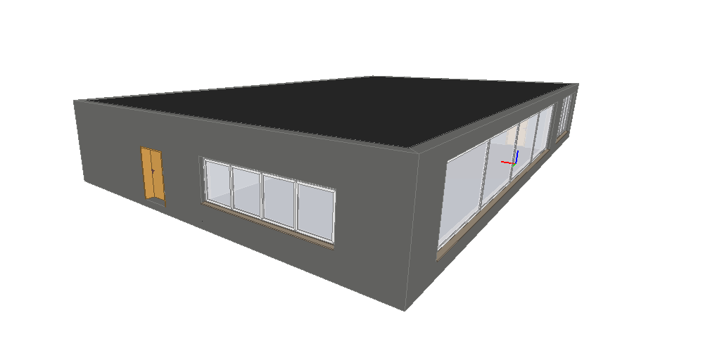
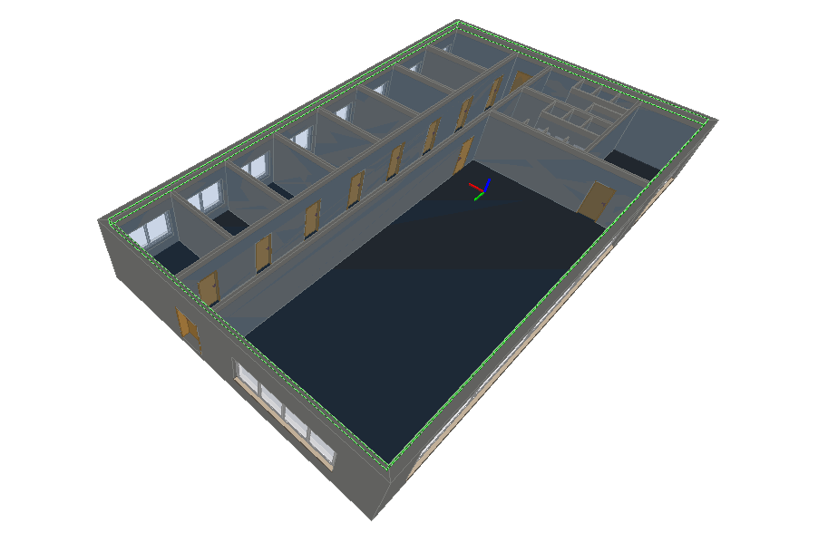
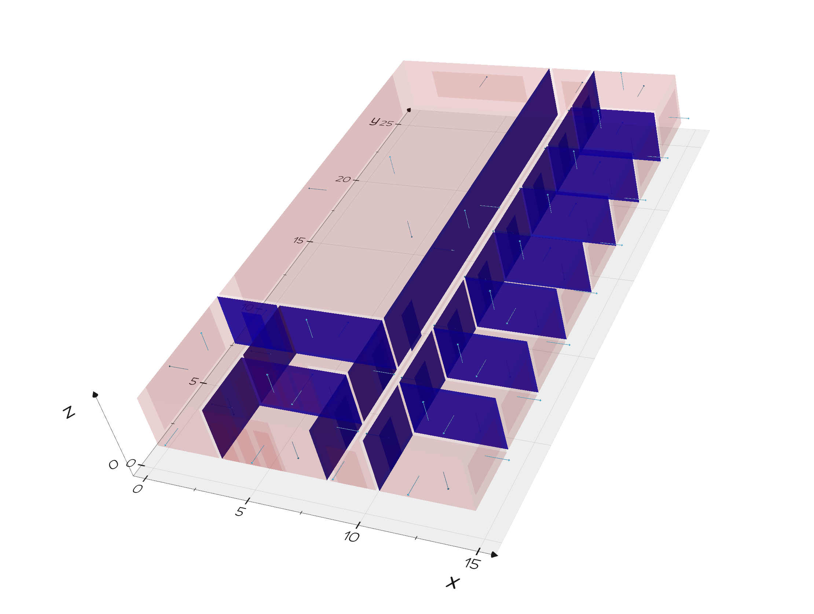
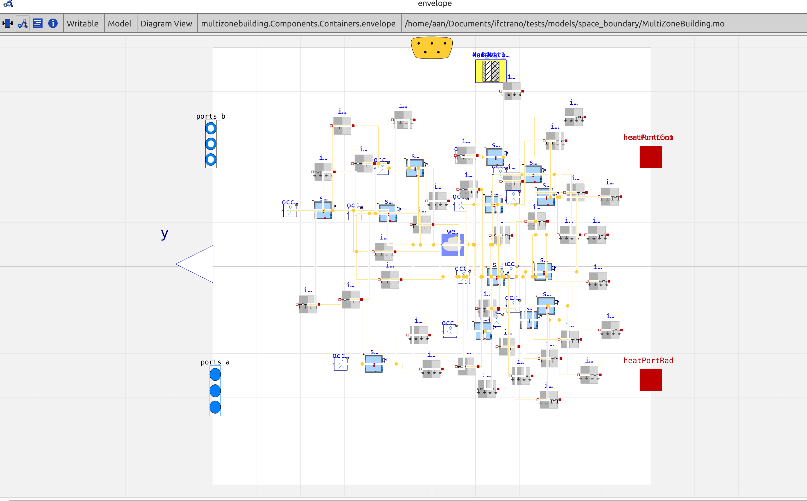

# Many zones model

ifctrano makes one thermal zone per `IfcSpace`, and couples the zones through the walls and slabs they share. This
tutorial uses `MultiZoneBuilding.ifc` from `tests/models/space_boundary`.





```python
from pathlib import Path

from ifctrano.building import Building

building = Building.from_ifc(Path("MultiZoneBuilding.ifc"))
building.save_model()
```

or, showing the space boundaries and simulating the model:

```bash
ifctrano create MultiZoneBuilding.ifc --show-space-boundaries --simulate-model
```

The space boundaries derived from the geometry: external surfaces in red, surfaces shared between spaces in blue.



The generated model in OpenModelica (taken with an earlier version; the layout may differ):



## Results

The building has no heating model: the zones are free-floating. With more zones than lines can show clearly, the
figure draws the range of the zone temperatures (minimum to maximum) and their mean.

{!tutorials/figures/many_zones.html!}

{!tutorials/figures/many_zones.md!}
