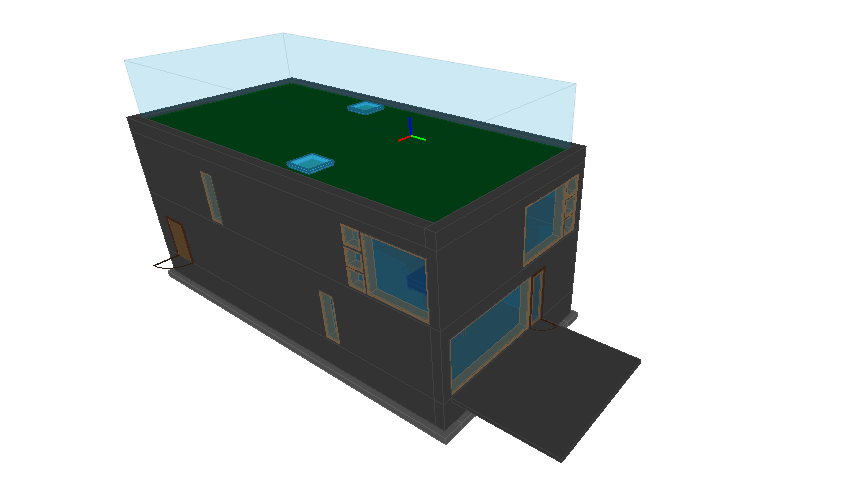
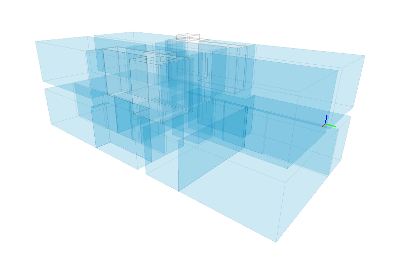
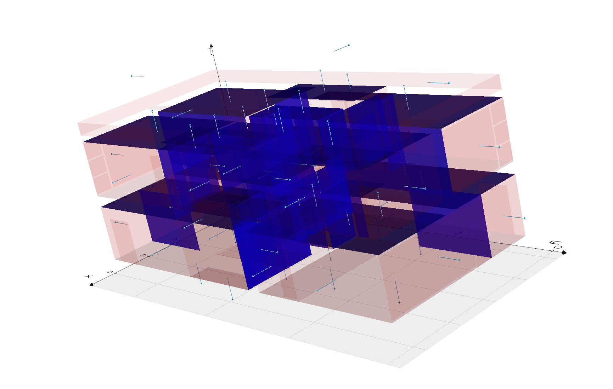
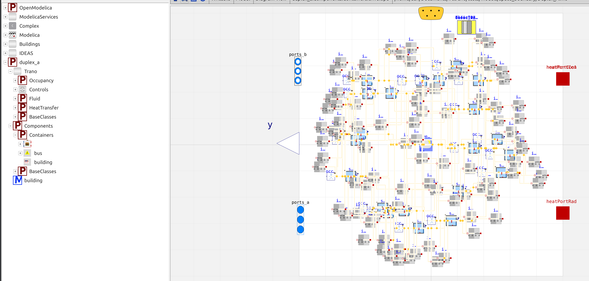

# Realistic model

This tutorial uses a realistic BIM model: the duplex apartment sample model, a two-storey dwelling with many rooms
(`Duplex_A.ifc` in `tests/models/space_boundary`).





```python
from pathlib import Path

from ifctrano.building import Building

building = Building.from_ifc(Path("Duplex_A.ifc"))
building.save_model()
```

or

```bash
ifctrano create Duplex_A.ifc --show-space-boundaries --simulate-model
```

The space boundaries derived from the geometry:



The generated model in OpenModelica (taken with an earlier version; the layout may differ):



## Results

Free-floating zones (the model has no heating) for the first ten days of January.

{!tutorials/figures/realistic.html!}

{!tutorials/figures/realistic.md!}

**What to expect.** Most rooms stay between the outdoor temperature and 15 °C without heating; rooms with large
windows and little floor area heat up in the sun.

**What the simulation shows.** The mean of the 21 zones is 12 °C over days 3 to 10, most rooms averaging between 10
and 13.5 °C. Two rooms stand out:

- A102 averages 13 °C but peaks at about 43 °C on sunny afternoons. It has 11.7 m² of windows for 27.7 m² of floor,
  and, like every room, constructions made of ifctrano's default material, an insulation-like material of 80 kg/m³
  (see [the limitations](../explanation/index.md#assumptions-and-known-limitations)): almost no thermal mass absorbs
  the solar gains. Such peaks in January are an artefact of the default material properties.
- The roof space R301 averages 20 °C: no roof surface was found for it (only 31.6 m² of external wall for 135 m² of
  floor), so the internal gains of its large floor area have little surface to escape through.

Edit the `material` section of the configuration with the real properties of the materials, and check the space
boundaries (`--show-space-boundaries`), before drawing conclusions on overheating.
