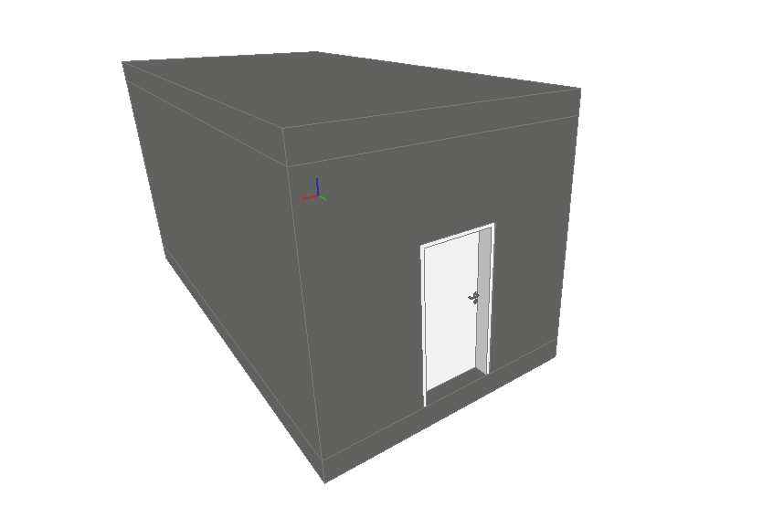
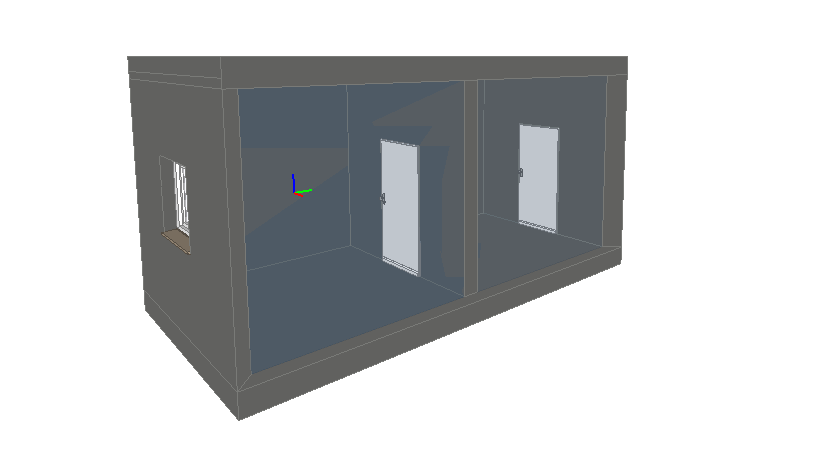
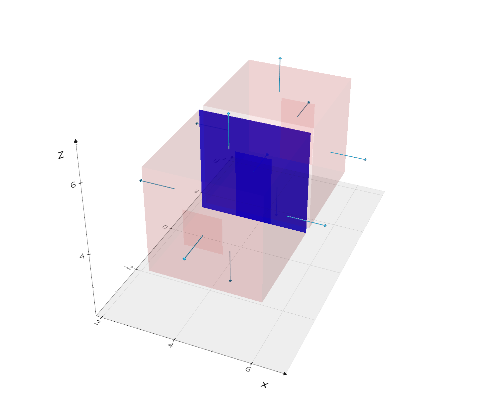
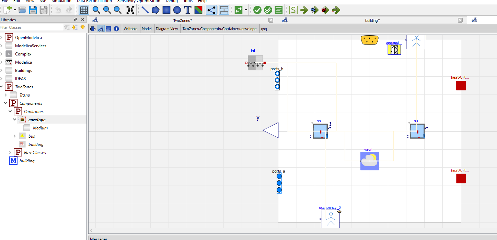

# Two zones model

This tutorial generates the Modelica model of a small building with two spaces, simulates it and reads the results.
The IFC file, `TwoZones.ifc`, is in `tests/models/space_boundary` of the repository.





## Generate the model

```python
from pathlib import Path

from ifctrano.building import Building

building = Building.from_ifc(Path("TwoZones.ifc"))
building.show()  # space boundaries computed from the geometry
building.save_model()  # TwoZones.mo next to the IFC file, for the Buildings library
```

`building.show()` displays the space boundaries ifctrano derived from the geometry: the surfaces each space shares
with the walls, slabs, roof and windows around it, and with the other space.



The same from the command line (`ifctrano create --help` lists the options):

```bash
ifctrano create TwoZones.ifc --show-space-boundaries
```

The model opens in OpenModelica (or Dymola) once the Buildings library is loaded. The diagram below was taken with an
earlier version; the layout of the components may differ.



## Simulate

With Docker running, `--simulate-model` simulates the model in OpenModelica and opens an HTML report of the results:

```bash
ifctrano create TwoZones.ifc --simulate-model
```

## Results

The building has no heating model, so the zones are free-floating: their temperature results from the losses through
the envelope, the solar gains through the windows and the internal gains of the occupants. The figure shows the first
ten days of January in Uccle (trano's default weather).

{!tutorials/figures/two_zones.html!}

{!tutorials/figures/two_zones.md!}

**What to expect.** Without heating, the zones settle between the outdoor temperature (dotted line) and the comfort
range: the envelope loses heat to the outdoor air, while the occupants and the sun bring heat in. Only zone `01 (uj9)`
has a window (1 m²), so it warms up more on sunny days.

**What the simulation shows.** Over days 3 to 10, the mean air temperature of the zones is about 9 °C. The zone with
the window averages 9.7 °C and reaches about 17 °C on sunny afternoons; the other averages 8.1 °C and stays within 6
to 11 °C. Both stay well above the outdoor temperature: the default
constructions are very insulating (see [the limitations](../explanation/index.md#assumptions-and-known-limitations)).

