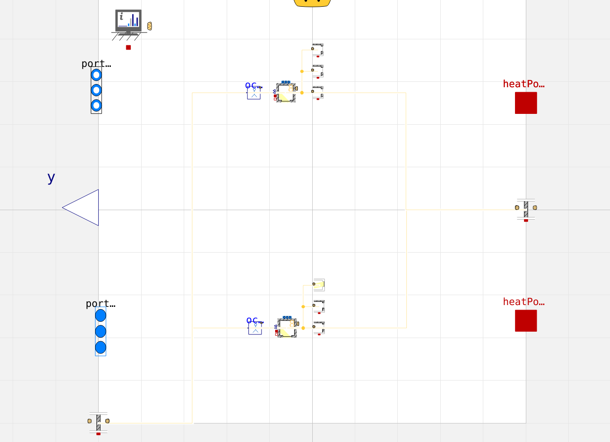

# Use different libraries

ifctrano generates models for four Modelica libraries:

| `LIBRARY` | Library | Zone model |
|---|---|---|
| `Buildings` (default) | [Buildings](https://simulationresearch.lbl.gov/modelica/) | Detailed: every surface, layer and window |
| `IDEAS` | [IDEAS](https://github.com/open-ideas/IDEAS) | Detailed: every surface, layer and window |
| `reduced_order` | [AixLib](https://github.com/RWTH-EBC/AixLib) | Reduced order: resistance–capacitance network |
| `iso_13790` | [AixLib](https://github.com/RWTH-EBC/AixLib) | ISO 13790 5R1C simple hourly method |

The library is given to `save_model`:

```python
from pathlib import Path

from ifctrano.building import Building

building = Building.from_ifc(Path("TwoZones.ifc"))
building.save_model(library="IDEAS")
```

or as the second argument of `ifctrano create`:

```bash
ifctrano create TwoZones.ifc IDEAS
```

The IDEAS model of the two zones, as opened in OpenModelica (taken with an earlier version; the layout may differ):



## Results

The same configuration of the [two zones model](two_zones_model.md) simulated with Buildings and IDEAS, for the first
ten days of January, without heating. The figure shows the mean air temperature of the two zones.

!!! note "AixLib models"
    ifctrano generates the `reduced_order` and `iso_13790` models, but trano 0.42.0 cannot simulate them: its
    OpenModelica script does not load AixLib ("Base class AixLib.Media.Air not found"). The fix is
    [trano#44](https://github.com/andoludo/trano/pull/44); both libraries will be added to this comparison with the
    trano release that includes it. Until then, `--simulate-model` fails for these two libraries, while the generated
    models can be simulated in OpenModelica or Dymola after loading AixLib.

{!tutorials/figures/libraries.html!}

{!tutorials/figures/libraries.md!}

**What to expect.** Both libraries describe each wall, window and floor with the same constructions, so free-floating
temperatures should be close; differences come from the models of the convection, the radiation exchange, the
windows and the ground.

**What the simulation shows.** Over days 3 to 10, the mean temperature of the zones is 8.9 °C with Buildings and
8.8 °C with IDEAS, with minima of 6.0 and 5.8 °C and maxima of 13.9 and 13.8 °C: the two detailed libraries agree
within 0.2 K on this building.

